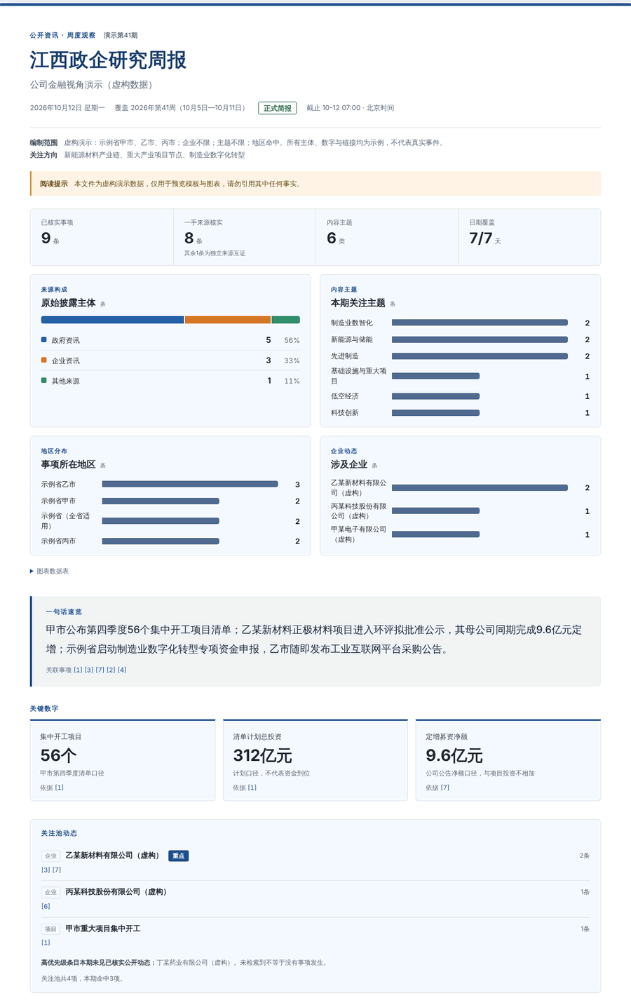
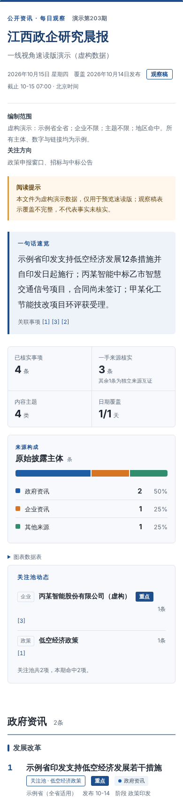
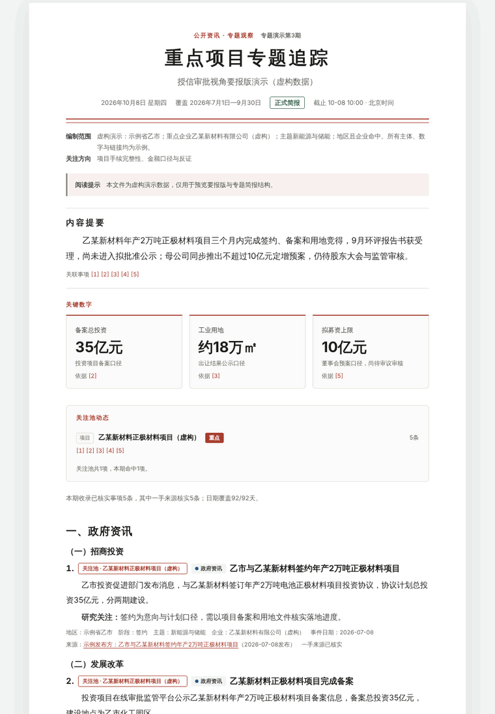

# 江西政企研究简报（银行业版）

给在江西展业的银行业金融机构用的研究简报技能：按**你的岗位**和**你的关注池**，编制每条都能追到原文的江西政企晨报、周报、月报和专题追踪。覆盖江西省、11个设区市及县区的政策文件、重大项目、环评与招采公示、企业公告和金融同业公开动态。

- 技能标识：`jiangxi-bank-briefing` · 版本 `1.0.0` · 入口 `SKILL.md`
- 父技能：[regional-enterprise-briefing](https://github.com/zleo-ai/regional-enterprise-briefing) 2.0.0 的江西银行业子集

| 标准版周报 · 关注池动态 | 速读版晨报（手机） | 要报版 · 项目追踪 |
|---|---|---|
|  |  |  |

<sub>截图使用 `examples/gallery/` 的虚构演示数据，主体、数字和链接都不是真实事件。</sub>

## 三个可定制层

| 层 | 你说 | 技能做 |
|---|---|---|
| **岗位视角** | “我是普惠条线的” | 映射到22种银行岗位之一（公司金融、普惠、科技、绿色、涉农、交易银行、投行、风险、授信审批、内控合规、行领导、一线客户经理……），按岗位调整排序和跟踪问题 |
| **岗位画像** | “我做园区金融服务，主要看开发区政策和园区企业投产，消费类少看” | 记为自定义岗位，研究方向显示在报头“关注方向”，并决定速览和研究关注的取舍 |
| **关注池** | “把江西铜业、赣锋锂业和南昌高新区加进来，赣锋设重点” | 企业、项目、园区、专题、政策最多300项；每期单独检索高优先级条目，报告列出命中动态和“本期未见公开动态”的重点条目 |

关注池可以在Excel里维护：`pool-template` 生成模板，另存为“CSV UTF-8”后用 `pool-import` 导入。

## 关注池不是客户名单

关注池只放可以公开研究的对象：每项必须确认 `public_ok=true`；备注、标签和岗位描述中出现授信、额度、余额、存款、账户、联系人、电话、“我行/本行客户”等内容时，工具直接拒绝。用户声明是内部客户名单时，技能不提交外部检索。报告不输出贷款需求判断、营销线索、授信意见或投资建议，`lint` 会拦截这类措辞。

## 30秒上手

```text
出一份昨天的江西政企晨报
我是公司金融条线，看赣州和南昌上周的重大项目，用要报版
我做绿色金融，主要看新能源项目环评和节能技改，房地产不用看
关注池里的企业最近一个月有什么动静，做成给领导看的
```

## 命令行

基础功能只需 Python 3.10+ 标准库；PNG导出另需 Playwright 与本地 Chromium/Chrome/Edge。

```bash
python3 scripts/briefing_tool.py options                                        # 岗位视角、关注池类型、设区市、版式
python3 scripts/briefing_tool.py validate-config examples/config-corporate-ganzhou.json
python3 scripts/briefing_tool.py pool-template --out 关注池模板.csv
python3 scripts/briefing_tool.py pool-import --csv 关注池.csv --out 关注池.json
python3 scripts/briefing_tool.py window --kind weekly --as-of 2026-10-15T07:00:00+08:00
python3 scripts/briefing_tool.py lint   --data examples/gallery/demo-weekly.json
python3 scripts/briefing_tool.py render --data examples/gallery/demo-weekly.json --out preview.html
python3 scripts/export_png.py --data examples/gallery/demo-daily.json --out share.png
python3 -B -m unittest discover -s tests
```

已存在的输出文件不会被覆盖；HTML不含脚本、远程字体和导出按钮。

## 目录

```text
SKILL.md                      智能体入口
references/
  configuration.md            配置字段、江西地区规则、岗位画像、关注池字段、范围真值表
  watch-pool.md               关注池指南：边界、建立、Excel导入、优先级、维护
  periodic-analysis.md        周月信号、专题模板、岗位视角目录
  source-map.md               江西信源地图与检索式
  workflow.md                 时间窗、证据门、中间文件与渲染契约
  writing-style.md            写作规范与禁用措辞
  templates.md                版式、配色、图表与关注池面板
  sources-safety.md           信源、隐私与异常处置
  optional-connectors.md      可选连接器
scripts/                      briefing_tool.py · report_design.py · export_png.py
assets/report.css             4配色×3版式样式
examples/                     配置、关注池CSV模板、报告示例；gallery/ 为虚构演示数据
evals/                        行为与触发评测
docs/operations.md            运营与质量方案、与父技能同步方式
tests/                        标准库单元测试
```

## 示例

| 文件 | 内容 |
|---|---|
| `examples/config-minimal.json` | 只填岗位视角，默认江西全省 |
| `examples/config-corporate-ganzhou.json` | 公司金融：赣州+南昌、岗位画像、关注池 |
| `examples/config-custom-role.json` | 自定义岗位“园区金融服务专员” |
| `examples/config-risk.json` | 风险管理，要报版 |
| `examples/pool-template.csv` | 关注池Excel模板 |
| `examples/gallery/demo-*.json` | 晨报、周报、专题的虚构演示数据（含关注池） |

## 数据与验证边界

仓库只含技能本体和示例，不含任何机构的客户名单、配置、运行记录或凭证；示例中的企业为公开上市公司或公开园区，仅演示格式，不代表任何客户关系。本地单元测试覆盖配置、江西地区校验、岗位画像、关注池、CSV导入、周期、渲染、模板、lint与导出边界；实时采集效果和Windows实机不在验证范围。

本项目尚未指定开源许可证。
